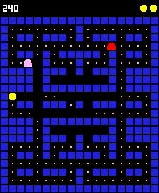

# 6.5280-2K1J — Cloud-gaming Pac-Man scaffold

A server hosts a Pac-Man game, captures a frame every tick, encodes it and
streams it over the network. A thin client on the player's machine displays the
frames and sends keyboard input back. This is the scaffolding for the project in
the design spec ("6.5820 Project Proposal"): speculative rendering, deadline-aware
frame scheduling and adaptive pacing/bitrate are **not** implemented yet — this
repo is the working baseline stream they plug into.



## Quick start

Requires Python 3.10+.

```bash
python3 -m venv .venv && source .venv/bin/activate
pip install -e ".[dev]"          # numpy, Pillow, pygame, pytest
```

**Server** (machine that hosts the game; works with no ROM and no emulator):

```bash
python -m cloudpac.server --host 0.0.0.0 --port 5280
```

**Client** (your local machine; opens a window):

```bash
python -m cloudpac.client --host <SERVER_IP_OR_HOSTNAME> --port 5280
```

Steer with arrow keys or WASD; Esc quits. The server address is the only thing
you need to change to play against a remote machine. Open TCP port `5280` in the
server's firewall / cloud security group. Running both on one machine:
`--host 127.0.0.1` (the client default).

The client needs `numpy`, `Pillow` and `pygame`; the server only `numpy` and `Pillow`.

### Headless client, traces and tests

```bash
# no window; random inputs for 10 s; prints fps / bandwidth / input->frame latency
python -m cloudpac.client --host <SERVER_IP> --headless --duration 10 --random-inputs --screenshot last.png
# record a session's inputs, replay them later
python -m cloudpac.client --host <SERVER_IP> --record traces/my-run.jsonl
python -m cloudpac.client --host <SERVER_IP> --headless --replay traces/example.jsonl
pytest
```

Server flags: `--fps` (default 30), `--quality` (JPEG, default 80), `--source stub|mame`,
`--rom-dir roms`, `--deadline-ms`. Client flags: `--scale`, `--headless`, `--duration`,
`--replay`, `--random-inputs`, `--record`, `--screenshot`.

## Architecture

```
 client machine                                     server machine
┌────────────────────────┐   INPUT (seq, action)   ┌──────────────────────────────┐
│ keyboard / replay trace│ ───────────────────────▶│ session: latest input        │
│                        │   FEEDBACK (rx stats)   │   │                          │
│ decode JPEG, display   │ ───────────────────────▶│   ▼                          │
│ measure input→frame ms │◀─────────────────────── │ FrameSource.step → render    │
└────────────────────────┘   FRAME (tags + JPEG)   │   → JPEG encode → send/drop  │
                                                   └──────────────────────────────┘
```

| Spec section | Where it lives |
|---|---|
| Game server / client, input replay, baseline stream (Oct 17–23) | `cloudpac/server.py`, `cloudpac/client.py`, `cloudpac/replay.py` — **done** (baseline = no speculation, one frame per tick) |
| "Small deterministic game" / Pac-Man backup | `cloudpac/sources/stub_pacman.py` (deterministic, original assets, `snapshot()`/`restore()`) |
| "Each frame encoded independently" | `cloudpac/codec.py` (per-frame JPEG) |
| "Frames tagged with starting game state, input sequence, display deadline" | `FrameHeader` in `cloudpac/protocol.py` (`base_tick`, `input_seq`, `deadline_ms`, plus `flags`/`branch_id` for speculative alternatives) — fields exist, only non-speculative values are sent |
| Client feedback loop (Fig. 1) | `FEEDBACK` message, sent every 1 s by the client; server only logs it (`-v`) |
| Essential metric: input → displayed result | Client measures time from sending an input to receiving the first frame that reflects it (`input_seq`), reported in the summary. It is measured at frame *receipt* (decode finished), not display refresh. |
| Predictor, bounded frame generation, client-side matching (Oct 31–Nov 6) | not implemented |
| Probability-first and deadline/network-aware scheduling (Nov 7–13) | not implemented (the server only drops a frame if >256 KiB is already queued: `MAX_BACKLOG_BYTES`) |
| Adaptive pacing and bitrate control (Nov 14–20) | not implemented (fixed fps and JPEG quality) |
| Network emulation, RTT/bandwidth/jitter/loss; diagnostics (Oct 24–30) | not implemented; basic fps/kbit/s/latency stats exist. Use `tc netem` on the server for now |

### Code map

- `cloudpac/sources/base.py` — `FrameSource`: `reset / step(action) / render / snapshot / restore`. The only thing the server knows about the game. Speculation will use `snapshot()` → `step(guessed inputs)` → `render()` → `restore()`.
- `cloudpac/sources/stub_pacman.py` — default, ROM-free Pac-Man-like game (own maze/sprites, 2 ghosts, lives, score).
- `cloudpac/sources/mame.py` — placeholder for an emulator-backed source; raises `NotImplementedError`.
- `cloudpac/protocol.py` — wire format (length-prefixed binary messages over one TCP connection; documented at the top of the file).
- `cloudpac/server.py` / `cloudpac/client.py` — as described above; one independent game session per client connection.

## Emulator options (and how to supply ROMs)

The spec does not name an emulator, and the user is new to emulators, so the
default is the built-in `stub` source behind the `FrameSource` interface: the
whole pipeline works today without any ROM. **No ROMs or copyrighted assets are
committed**; `roms/` is git-ignored except its README.

When you want the real arcade game, the realistic options are:

1. **libretro core via Python (`libretro.py`)** — recommended for this project.
   Cores (`mame2003_plus`, `fbneo`, ...) expose `retro_serialize/unserialize`
   (save states) and deterministic single-frame stepping, which map directly onto
   `snapshot()/restore()` and the "tick" model used here.
2. **MAME driven by a Lua `-autoboot_script`** — easiest to install
   (`apt install mame`), runs `pacman` natively, but frame capture goes through the
   Lua API / pipes and there is no cheap save/restore, so speculation would
   require running ahead from a save state or replaying inputs.
3. **Keep a simulator** (the stub, or a re-implementation) — what the spec's
   "small deterministic game" hints at; trivially deterministic and fast.

To supply a ROM yourself: obtain `pacman.zip` legally (from hardware you own),
put it in `roms/`, and once an emulator source exists run
`python -m cloudpac.server --source mame --rom-dir roms`. Today that command exits
with a "not implemented" message.

## Verification performed

See the PR description for the exact runs. In short: unit tests (`pytest`, 10
tests: game determinism and snapshot/restore, protocol/codec/trace round trips,
in-process server+client loopback) plus server and client run as separate
processes, both over loopback and over the machine's non-loopback IP, including
the windowed client under SDL's dummy video driver.

## Assumptions and open questions

- **Which emulator / is an emulator required?** Spec question (1) asks whether a deterministic game with replayed inputs suffices; the scaffold assumes yes, with the stub as the primary source. A real emulator source is optional.
- **Determinism and state capture** for the chosen emulator: can the core snapshot/restore every frame cheaply enough for several speculative branches per tick? Unknown until a core is chosen and benchmarked.
- **Tick model:** one `step()` = one game tick = one frame at a fixed 30 fps. The arcade Pac-Man runs at ~60 Hz; if an emulator is used, pick the fps and input-hold semantics (held direction vs per-frame joystick) to match.
- **Inputs:** discrete actions UP/DOWN/LEFT/RIGHT/NONE; `NONE` means "keep the last direction". Pac-Man-style sticky direction is a game rule, not a transport rule.
- **Transport:** a single TCP connection for simplicity. TCP head-of-line blocking will distort latency/loss experiments (spec's loss/jitter/pacing); a UDP-based or QUIC transport is likely needed for the later phases.
- **Security:** no authentication or encryption; do not expose the port to the open internet beyond experiments.
- **Cloud deployment (spec question 4)** is not addressed; the server is a plain Python process.
- **Codec:** JPEG per frame (~23 KB/frame at quality 80 for this simple frame, ~5.5 Mbit/s at 30 fps); a tuned codec/quality ladder is future work.
- **Multiple clients:** each connection gets its own game session; no shared or spectator mode.
